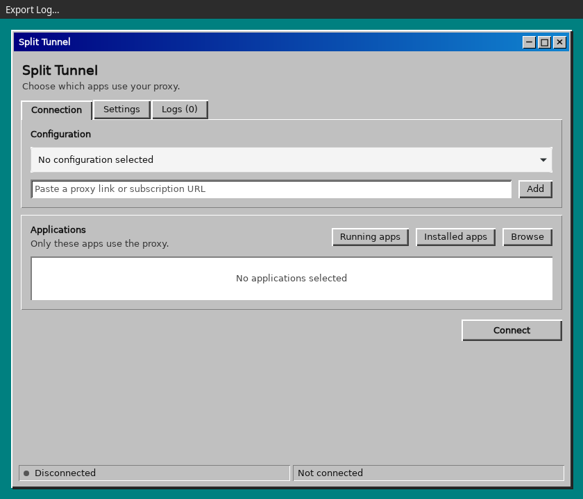
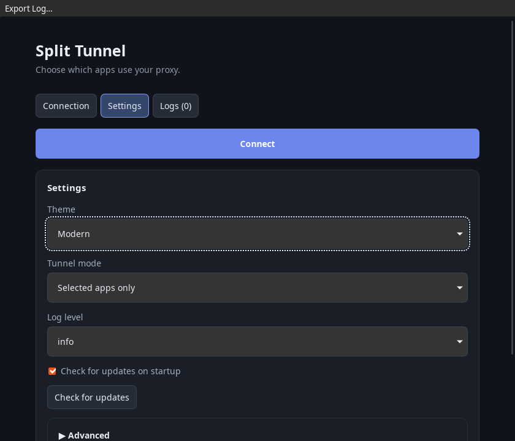

# Split Tunnel

[](https://github.com/MohamadrezaKazemian/split-tunnel-v2ray/actions/workflows/ci.yml)
[](LICENSE)

A desktop app for process-based split tunneling with Tauri, React, and sing-box.

Classic theme:



Modern theme:



[Classic theme at a narrow window size](docs/screenshots/classic-narrow.png)

**Experimental:** Windows has not been tested on a real machine. Routing and DNS isolation are not fully verified on either platform.

## Features

- Select whole installed or running applications, individual executables, or matching terms; view live process counts.
- Import supported VLESS, VMess, Trojan, and Shadowsocks links or subscriptions.
- Test profiles with TCP and proxy delay measurements, including batch and live ping.
- Choose selected-apps-only, all-except-selected, or whole-system tunnel routing, then connect and disconnect.
- Export, copy, or clear live logs; exported details are redacted by default.
- Check GitHub releases, including prereleases, and install signed updates on supported installations.
- Switch between Classic and Modern themes; Classic is the default.
- Linux polkit elevation and experimental Windows UAC support.

## How it works

The app generates a configuration and orchestrates an unmodified sing-box 1.14.4 binary. sing-box creates a TUN interface and applies process matching rules to route traffic through a supplied proxy or directly. DNS attribution and process matching have limitations described below. The [sing-box source for v1.14.4](https://github.com/SagerNet/sing-box/tree/v1.14.4) and its [source archive](https://github.com/SagerNet/sing-box/archive/refs/tags/v1.14.4.tar.gz) are available upstream. See [third-party notices](THIRD_PARTY_NOTICES.md) for licensing.

## Downloads

Windows builds are experimental.

| OS and format | Download | Which should I pick? |
| --- | --- | --- |
| Linux x64, Debian package | [split-tunnel-v2ray_0.2.0_linux_amd64.deb](https://github.com/MohamadrezaKazemian/split-tunnel-v2ray/releases/download/v0.2.0/split-tunnel-v2ray_0.2.0_linux_amd64.deb) | Install on Debian or Ubuntu. |
| Linux x64, AppImage | [split-tunnel-v2ray_0.2.0_linux_amd64.AppImage](https://github.com/MohamadrezaKazemian/split-tunnel-v2ray/releases/download/v0.2.0/split-tunnel-v2ray_0.2.0_linux_amd64.AppImage) | Run without installing; make the file executable first. |
| Arch Linux x64 | [split-tunnel-v2ray_0.2.0_linux_x86_64.pkg.tar.zst](https://github.com/MohamadrezaKazemian/split-tunnel-v2ray/releases/download/v0.2.0/split-tunnel-v2ray_0.2.0_linux_x86_64.pkg.tar.zst) | Install with `sudo pacman -U ./split-tunnel-v2ray_0.2.0_linux_x86_64.pkg.tar.zst`. AUR support is coming. |
| Windows x64, installer | [split-tunnel-v2ray_0.2.0_windows_x64-setup.exe](https://github.com/MohamadrezaKazemian/split-tunnel-v2ray/releases/download/v0.2.0/split-tunnel-v2ray_0.2.0_windows_x64-setup.exe) | Use the installer for normal setup. |
| Windows x64, portable | [split-tunnel-v2ray_0.2.0_windows_x64-portable.zip](https://github.com/MohamadrezaKazemian/split-tunnel-v2ray/releases/download/v0.2.0/split-tunnel-v2ray_0.2.0_windows_x64-portable.zip) | Extract and run without installation; administrator access and WebView2 are still required. |

Verify downloads using [SHA256SUMS.txt](https://github.com/MohamadrezaKazemian/split-tunnel-v2ray/releases/download/v0.2.0/SHA256SUMS.txt).

## Usage

Supply your own proxy link or subscription, select applications when using a split-tunnel mode, choose a routing mode, and connect. **Whole system** needs no selected applications: it tunnels all non-local traffic and DNS. On Linux, approve the polkit prompt. See the development and privilege details below.

**Disclaimer:** This app does not provide servers or configurations. Use it lawfully. The author takes no responsibility for misuse. Do not rely on this experimental software to protect privacy or prevent DNS leaks.

## FAQ

**Does this app include a server or subscription?** No; bring your own compatible configuration.

**Does selecting a parent automatically include its children?** No. See the process and DNS limitations below.

**Is Windows production-ready?** No. It is experimental and the [Windows test plan](docs/WINDOWS_TEST_PLAN.md) has not been completed on a real machine.

**How do updates work?** The app checks published GitHub releases on startup, including prereleases. You can disable the check or run it manually in Settings. AppImage and recognized Windows NSIS installations can download a signed update and restart after verification; disconnect the tunnel first. Debian and Arch packages are updated manually using the command shown in the app. Other installations need a manual download. Download and signature failures do not replace the current installation. Review the update notes before installing.

Release builds require `TAURI_SIGNING_PRIVATE_KEY` and `TAURI_SIGNING_PRIVATE_KEY_PASSWORD` as GitHub Actions secrets. The release workflow signs the AppImage and NSIS installer, publishes their `.sig` files and a version-specific `latest.json`, and includes those assets in `SHA256SUMS.txt`. The configured public key verifies updates; never add the signing private key to the repository. Real published-release upgrades and Windows elevated updates have not been tested yet.

## Build from source

A Tauri 2 desktop prototype for selecting apps and generating sing-box 1.14.4 split-tunnel configurations. Linux elevation uses polkit. Windows builds request administrator privileges through UAC; the Windows implementation has not been tested on a real Windows machine. End-to-end routing and DNS isolation are not verified; do not rely on this prototype to prevent DNS leaks or protect privacy.

## Run in development

1. Install Node.js, pnpm, stable Rust, and the [Tauri 2 prerequisites](https://v2.tauri.app/start/prerequisites/) for your OS. On Linux, also install `pkexec` and make sure your desktop has a polkit authentication agent.
2. Open a terminal in the project directory and run:

   ```sh
   pnpm install
   pnpm setup:engine
   pnpm tauri dev
   ```

3. Add a proxy link or subscription, select the applications to tunnel, and choose **Connect**. On Linux, approve the polkit prompt when it appears. Run the GUI as your normal user, without `sudo`.

For later development sessions, `pnpm tauri dev` is enough while the dependencies and sidecar are still installed. `pnpm dev` alone starts only the Vite frontend; use `pnpm tauri dev` to run the desktop app and its Rust backend.

`pnpm setup:engine` downloads the official sing-box 1.14.4 archive for the current Linux or Windows x64/arm64 machine, verifies a pinned SHA-256 checksum, and installs the executable in the ignored `src-tauri/binaries` directory with the Tauri target-triple suffix. It requires `rustc` and `tar` (modern Windows provides bsdtar). Run it before `pnpm tauri dev` or `pnpm tauri build`: Tauri requires the configured sidecar to exist at build time.

At runtime the app searches next to its executable for the Tauri sidecar, then `./bin/sing-box` in the project directory during development (or the working directory in a packaged app), then `sing-box` on PATH. If none is found, Connect displays `Engine missing, run pnpm setup:engine`. Settings → Advanced offers an optional override. A saved override is used only while it points to an executable file; otherwise discovery continues automatically. A polkit authentication agent and an authorization policy permitting `pkexec` are required on Linux. The GUI and its saved data stay under the normal user account; on Connect, `pkexec` elevates a supervisor that launches the selected executable as root. Only use a trusted engine: it executes with root privileges. On Windows the whole app requests administrator privileges through UAC; Windows behavior has not been validated on a real machine.

For an AppImage, the privileged supervisor runs from a temporary extraction of the same AppImage, because root normally cannot access the GUI user's FUSE mount. The bundled engine is taken from that extraction; an engine override outside the AppImage is still honored. The AppImage runtime normally cleans up the extraction after the supervisor exits. The installed-app picker uses an exact executable rule when an app is in a shared directory; helpers outside that executable need their own rule.

## Build the desktop app

Build on the OS and architecture you want to run. From a fresh checkout, install dependencies and download the sidecar first:

```sh
pnpm install
pnpm setup:engine
pnpm tauri build
```

### Linux

The default Linux build creates a Debian package in `src-tauri/target/release/bundle/deb/`. The sing-box sidecar is included; people installing the package do not need to run the setup script. For example, on Debian or Ubuntu, install the generated package with:

```sh
sudo apt install ./src-tauri/target/release/bundle/deb/*.deb
```

The release executable is also available at `src-tauri/target/release/split-tunnel-backend`. Keep the `sing-box` sidecar next to it if running the executable outside the package. To verify the package contains both files, replace the example filename with the generated package for your architecture:

```sh
dpkg-deb -c "src-tauri/target/release/bundle/deb/Split Tunnel_0.2.1_amd64.deb" | grep -E 'usr/bin/(split-tunnel-backend|sing-box)$'
```

Both executables should be listed next to each other. To compare the packaged sidecar with the setup download, pipe `dpkg-deb --fsys-tarfile <package>` into `tar -xOf - usr/bin/sing-box | sha256sum` and compare it with `sha256sum src-tauri/binaries/sing-box-<target-triple>`.

An AppImage can be requested with `pnpm tauri build --bundles appimage`; the v0.1.0 release AppImage was smoke-tested under Xvfb. Desktop polkit authorization and networking still need the platform checks described below.

### Arch Linux

Install the downloaded Arch package with:

```sh
sudo pacman -U ./split-tunnel-v2ray_<version>_linux_x86_64.pkg.tar.zst
```

The package includes the application and its bundled sing-box sidecar. Connecting requests administrator access through polkit. AUR support is coming; updates are manual with `pacman -U` until the AUR package is live.

### Windows 10/11 x64

On a Windows x64 machine, install the [Windows Tauri prerequisites](https://v2.tauri.app/start/prerequisites/), including the MSVC Rust toolchain, then run the three build commands above in PowerShell. The setup script verifies the Windows x64 sing-box 1.14.4 archive and installs `sing-box-x86_64-pc-windows-msvc.exe`. The upstream x64 build embeds Wintun, so a separate `wintun.dll` is not downloaded. The installer is expected under `src-tauri\target\release\bundle\nsis\` and should contain the sidecar. WebView2 is required; Tauri's installer normally bootstraps it when missing.

The app requests administrator access through its manifest. If UAC is declined, Windows does not start the app, so it cannot display its own cancellation message. For development, an elevated terminal may be needed because `cargo run` cannot display an elevation prompt for its child.

The Windows workflow in `.github/workflows/windows.yml` is configured to run tests, build an NSIS installer and inspect it for the engine. The workflow has built and inspected an installer on GitHub Actions. Windows privilege handling, shortcut scanning, process matching, adapter cleanup, DNS restoration and the installer have not been tested on Windows. Follow [the Windows test plan](docs/WINDOWS_TEST_PLAN.md) before relying on them.

Paste a VLESS, VMess, Trojan or Shadowsocks link, or an HTTP(S) subscription URL, then select applications from the installed-app list, a running process, or an executable/desktop file and connect. The installed list is scanned in the background and cached for the session. Running process counts refresh every five seconds and exclude the app and its resolved engine. Changes to rules take effect after reconnecting. Whole-app rules use the installation directory, while term rules match executable paths and the names observed when connecting. Review broad matches before using them. The subscription is fetched by the backend, follows up to five redirects, has a 20-second timeout and is limited to 2 MiB. The whole import fails if any subscription line is unsupported. Desktop launcher entries are resolved to an executable, including common `env` prefixes. Flatpak and Snap launchers are available as whole-app rules only when an app-specific installation directory can be identified; sandbox mount namespaces can still expose different paths. Shared launchers without an identifiable root are unavailable. Some launchers and sandboxed apps cannot be mapped reliably. Whole-app rules match every executable under their install root, including helpers and unrelated executables placed there. Versioned app folders are folded into the stable root. Running-app groups and counts include only processes whose executable paths are accessible. App icons are not implemented.

Configuration and app choices are saved in an app-local JSON file, including proxy credentials in plaintext. Linux creates that file with mode 0600. Keep the file and subscription URLs private.

`pnpm test`, `pnpm typecheck`, `pnpm build`, and `cargo test --manifest-path src-tauri/Cargo.toml` run the checks. To validate generated configs, set `SING_BOX` to a 1.14.4 executable and run `pnpm check:config`. Debug builds use line-table-only debug information.

## Privileged process lifecycle

The GUI owns a dedicated process-management thread and a control pipe to the elevated supervisor. Disconnect closes the pipe; if the GUI crashes or exits, the OS closes it. The supervisor asks sing-box to stop, waits for it, and uses a parent-death signal for its child. If graceful shutdown times out or the supervisor fails, the UI reports that cleanup could not be confirmed. A pidfile and Linux per-user lock track the supervisor. On a subsequent launch, the app waits briefly for a previous elevated supervisor to disappear and refuses to signal an unverifiable root-owned PID. If it remains, recovery requires administrator investigation; do not blindly kill a PID from an old file. A pending polkit prompt can outlive the GUI until the prompt is dismissed or resolved; the closed pipe then tells the supervisor not to keep the tunnel running.

Cancellation and authorization failures are reported as elevation errors. The generic polkit authorization can execute the selected program as root; no custom policy is installed. Windows uses a kill-on-close Job Object. Disconnect attempts CTRL+BREAK on a separate process group, waits up to five seconds, and logs a warning before forced termination if needed. It then checks for the uniquely named app TUN adapter and logs any remaining adapter or failed check. Windows signaling and route/DNS cleanup after disconnect or crash have not been verified on a Windows machine.

An isolated Linux user/network-namespace test exercised sing-box 1.14.4 with the resolver service isolated: both pipe closure and a simulated GUI crash removed the TUN and restored the namespace's routes and `resolv.conf`. Interactive polkit authentication, the actual desktop GUI close, real systemd-resolved/DNS restoration, and full host routing have not been verified. A resolver command can hang; forced termination is reported as unconfirmed cleanup and may leave resources behind.

## Routing and DNS limitations

TUN auto-routing intercepts system traffic before sing-box sends unmatched traffic directly. It can affect other traffic and has not been validated across OS configurations. Selected A/AAAA queries that sing-box can attribute to a process use fake IP; other selected DNS queries use remote DNS through the proxy. Sniffing does not guarantee attribution. A shared system resolver can make requests on an app's behalf, and cached answers or app-controlled encrypted DNS can bypass the intended per-app DNS policy. DNS leaks remain possible in split modes. **Whole-system mode is the more leak-resistant option**: it sends all DNS through the proxy, uses direct DNS only to bootstrap the proxy server name, and bypasses localhost/LAN ranges, the proxy endpoint, this app, and the engine to prevent routing loops. Its dual-stack TUN also routes IPv6. It is still experimental and has no kill switch: a tunnel failure can restore normal direct traffic until you disconnect or resolve the error. UWP, Flatpak and Snap applications may expose shared or namespace-specific process paths, so whole-app matching is not guaranteed. Child processes are matched by their own executable path, not inherited from the parent; a helper outside the selected root needs another rule. Generic Electron or shell launchers in shared directories cannot safely identify a single app. On Linux, process path matching is case-sensitive; Windows paths and term rules are case-insensitive. sing-box only supports exact process-name matching, so term rules match path substrings and process names observed at connection time; later processes with a different name and unrelated path may not match. The app inserts direct/local rules for its own executable and the resolved engine before user rules, but unavailable process attribution can still affect routing or DNS; do not rely on this as a leak guarantee.
